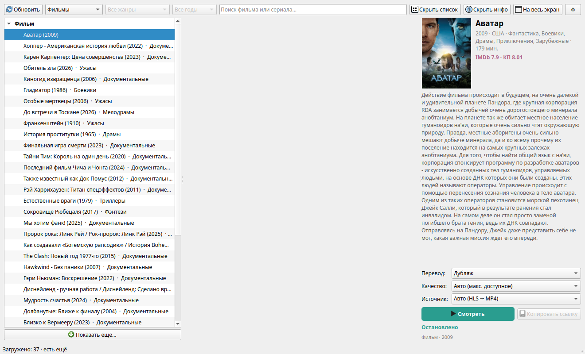
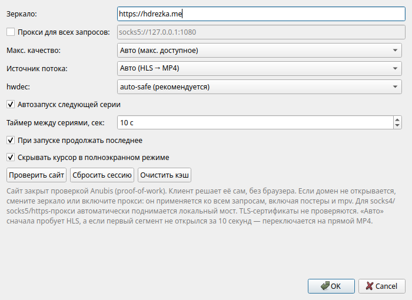
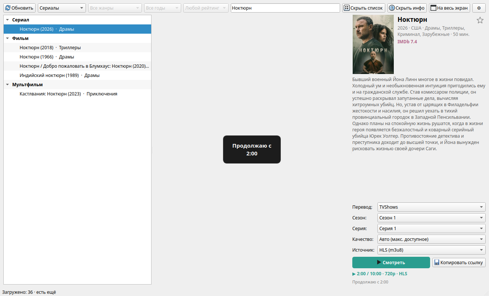
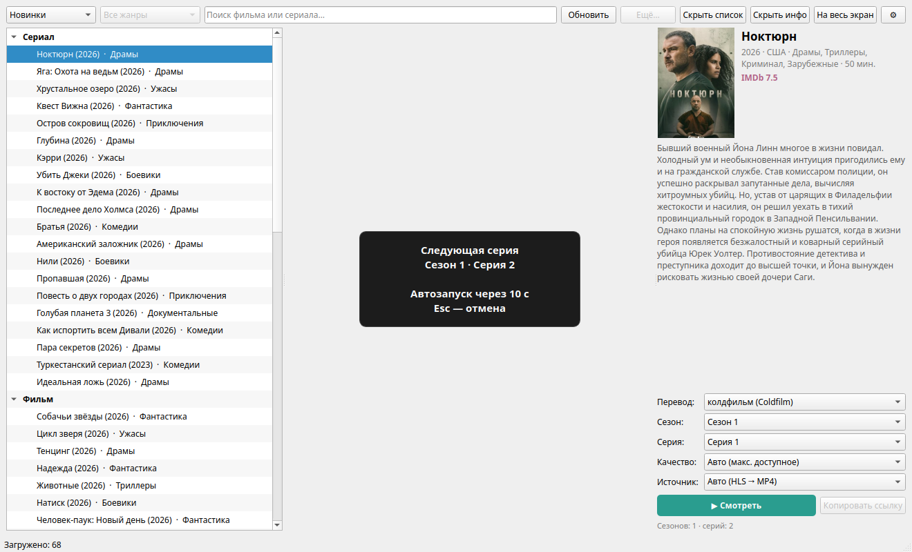

# HDrezka GUI

Настольное приложение для просмотра фильмов и сериалов **HDrezka** на компьютере.
Каталог, поиск, жанры, выбор перевода/сезона/серии и встроенный плеер — всё в одном окне.



## Возможности

- 📺 каталог «Новинки», фильмы, сериалы, мультфильмы, аниме и ТВ-шоу;
- 🎭 жанры рядом с названием и фильтр по жанрам;
- ⭐ локальное «Избранное»: первый пункт списка разделов, звёздочка
  в правом верхнем углу карточки;
- 📅 фильтр по году выпуска (подборки «Лучшее» на сайте);
- ⬇️ кнопка «Показать ещё…» в конце списка для следующей страницы;
- 🔍 поиск по названию фильма или сериала (полная выдача, а не только
  5 подсказок);
- 🖼️ постер, описание, год, страна, жанры и рейтинги;
- 🎚️ выбор качества: авто, 1080p, 720p, 480p, 360p;
- 🌐 выбор источника: HLS (m3u8) или прямой MP4;
- 🛡️ прокси для всех запросов: `http://`, `https://`, `socks4://`,
  `socks4a://`, `socks5://`, `socks5h://` — сайт, постеры и mpv;
- 🔓 проверка TLS-сертификатов отключена для всех запросов;
- 🎞️ встроенный плеер mpv и полноэкранный режим;
- 🖱️ автоскрытие курсора в полноэкранном режиме;
- 🔁 автозапуск следующей серии с плашкой-таймером;
- 💾 запоминание позиции просмотра и продолжение при следующем запуске;
- 📊 текущая позиция, длительность, качество и источник в правой панели;
- 🖥️ блокировка screensaver/засыпания экрана: D-Bus, X11/DPMS, systemd
  (в том числе на OpenRC-системах вроде Gentoo);
- 🧵 блокировки экрана выполняются в фоне — интерфейс не замирает
  при старте, переключении серий и пробуждении экрана;
- 💬 понятные сообщения «Подготовка…», «Буферизация…», «Продолжаю с…»;
- 📡 кэш главной страницы и настройки зеркала/прокси;
- 🤖 автоматическое прохождение проверки сайта «вы не бот».

## Установка и запуск

Для запуска нужен **Python 3.9 или новее**.

### Linux (Debian/Ubuntu)

```bash
sudo apt install mpv libmpv2 python3-venv
cd HDrezka
python3 -m venv .venv
. .venv/bin/activate
python3 -m pip install -r requirements.txt
python3 hdrezka_gui.py
```

### Windows

1. Установите Python 3.9 или новее.
2. В папке с программой откройте командную строку и выполните:

```bat
python -m venv .venv
.venv\Scripts\activate
python -m pip install -r requirements.txt
python hdrezka_gui.py
```

Для встроенного плеера на Windows нужен файл `mpv-2.dll`: положите его
рядом с `hdrezka_gui.py` или добавьте в `PATH`.

## Как пользоваться

1. Выберите раздел: «Новинки», «Фильмы», «Сериалы», «Мультфильмы», «Аниме»
   или «ТВ-шоу». Первым пунктом идёт локальное **«Избранное»**, но при
   запуске по умолчанию открываются «Новинки».
2. При необходимости выберите жанр и год выпуска. Год использует подборки
   сайта «Лучшее за год»; для «Новинок» и «ТВ-шоу» он недоступен.
3. Сайт отдаёт по 36 тайтлов на страницу. Внизу списка есть кнопка
   **«Показать ещё…»** — она догружает следующую страницу.
4. Найдите нужный тайтл через поиск или в списке.
5. Чтобы добавить фильм или сериал в избранное, нажмите звёздочку **☆**
   в правом верхнем углу карточки. Повторное нажатие убирает тайтл.
6. Справа выберите перевод, сезон, серию, качество и источник.
7. Нажмите **«Смотреть»**.

Для сериалов после окончания серии появится плашка со следующим эпизодом
и таймером. По умолчанию следующая серия запускается через 10 секунд.

### Избранное

- `favorites.json` хранит только `post_id` и время добавления.
- `favorites_cache.json` — необязательный кэш названий, годов, жанров и
  постеров для быстрого отображения.
- Если кэша нет, показывается `Тайтл #ID`, а метаданные догружаются в фоне.
- При удалении из избранного запись кэша тоже удаляется.

## Настройки

Нажмите на шестерёнку **⚙** в правом верхнем углу.



- **Зеркало** — адрес сайта. Если основной домен не открывается, попробуйте
  другое зеркало, например `https://hdrezka.co` или `https://rezka.ag`.
- **Прокси для всех запросов** — необязательно. Поддерживаются `http://`,
  `https://`, `socks4://`, `socks4a://`, `socks5://`, `socks5h://`.
  Прокси используется для сайта, постеров и mpv. Для socks/https-схем
  автоматически поднимается локальный HTTP-мост, потому что mpv понимает
  только `http://`-прокси. TLS-сертификаты не проверяются.
- **Макс. качество** — ограничение качества. «Авто» выбирает лучшее доступное
  и пропускает PRO-качества.
- **Источник потока** — «Авто» сначала пробует HLS, а если первый сегмент
  не открылся за 10 секунд, переключается на прямой MP4. Можно выбрать
  только HLS или только MP4.
- **hwdec** — аппаратное ускорение. Обычно оставьте `auto-safe`.
  Если видео чёрное или сильно тормозит — выберите `no`.
- **Автозапуск следующей серии** — включает плашку с обратным отсчётом
  и автоматический переход к следующей серии, в том числе в новый сезон.
- **Таймер между сериями, сек** — сколько ждать перед автозапуском
  (от 3 до 300 секунд).
- **При запуске продолжать последнее** — при старте приложение загрузит
  последний просмотренный тайтл и продолжит с сохранённого места.
- **Скрывать курсор в полноэкранном режиме** — курсор исчезает через
  2,5 секунды без движения мыши и возвращается при движении.
- **Проверить сайт** — проверить доступность зеркала и прокси.
- **Сбросить сессию** — заново пройти проверку сайта, если он перестал
  отвечать.
- **Очистить кэш** — загрузить список главной страницы заново.

> **Безопасность.** Проверка TLS-сертификатов отключена для сайта,
> постеров и mpv. Это помогает с самоподписанными сертификатами и
> корпоративными прокси, но трафик может быть перехвачен. Используйте
> только если понимаете риск.

## Автозапуск и продолжение просмотра

- Позиция сохраняется для каждого тайтла, перевода, сезона и серии отдельно.
- Сохранение происходит каждые 10 секунд, при выходе, при выборе другого
  тайтла и при запуске другой серии/перевода.
- Если для выбранной серии есть сохранённая позиция, справа до запуска видно:

  ```
  Сохранено: 12:34 — «Смотреть» продолжит
  ```

- После запуска показывается плашка `Продолжаю с 12:34`, а справа —
  живая информация:

  ```
  ▶ 12:34 / 45:00 · 1080p · HLS
  ```

- Если включена настройка **«При запуске продолжать последнее»**, при
  следующем запуске приложение само откроет последний тайтл (даже если
  он был найден через поиск), восстановит перевод/серию и начнёт
  воспроизведение с сохранённого места.



### Следующая серия



- По умолчанию следующая серия запускается через **10 секунд**.
- Если серия последняя в сезоне, запустится первая серия следующего сезона.
- **«Смотреть»** — запустить следующую серию сразу.
- **Esc** — отменить автозапуск.
- Если следующая серия уже смотрелась, она продолжится с сохранённого места.
- Для фильмов автозапуск не используется.

## Если что-то не работает

**Сайт не открывается или пишет «Проверяем, что вы не бот».**
Подождите несколько секунд и попробуйте снова. Если не помогает — смените
зеркало в настройках, включите прокси или нажмите **«Сбросить сессию»**.

**Не удалось получить ссылку / пустой список качеств.**
Нажмите **«Повторить»** в окне ошибки, выберите другой перевод или источник
MP4. Если ошибка повторяется — сбросьте сессию в настройках.

Для фильмов при ошибке выбранного перевода приложение автоматически
пробует остальные доступные переводы. Переводы, которых нет на странице
тайтла, не перебираются: сайт не отдаёт для них ссылку.

**Фильм есть, но видео не запускается.**
Если на странице написано «скоро онлайн» или «анонсы и трейлеры»,
видео ещё не выложено. Приложение покажет сообщение
«Видео ещё не добавлено — фильм только анонсирован». Никакой перевод
в этом случае не поможет.

**Не работает прокси, особенно SOCKS.**
Укажите схему полностью: `socks5://host:port`, `socks4://host:port`,
`https://host:port`. Для socks/https приложение поднимает локальный
HTTP-мост для mpv. Запустите с `HDREZKA_LOG=1` — в логе будут строки
`[proxy-bridge] started ...`. Если мост не поднялся, видео пойдёт напрямую,
а в строке состояния появится предупреждение.

**Долго открывается видео, особенно HLS.**
Поставьте источник **«Авто»** или **«MP4 (файл)»** в настройках или в правой
панели. Режим «Авто» сам переключится на MP4, если HLS не стартовал за
10 секунд.

**Чёрный экран, зелёные полосы или сильные тормоза.**
В настройках поставьте `hwdec: no`. Если не помогло — проверьте драйверы
видеокарты и обновите mpv.

**Во время просмотра гаснет экран или включается screensaver.**
Приложение блокирует засыпание несколькими способами:

- D-Bus: `org.xfce.ScreenSaver` (XFCE), `org.freedesktop.ScreenSaver`,
  `org.gnome.SessionManager`, `org.mate.ScreenSaver`,
  `org.cinnamon.ScreenSaver` и `org.freedesktop.PowerManagement`;
- X11: `XScreenSaverSuspend`, отключение DPMS и сброс idle-таймера
  каждые 20 секунд — это важно для OpenRC-систем (Gentoo, Alpine, Devuan),
  где нет `systemd-inhibit`;
- на XFCE дополнительно временно включается **Presentation Mode**
  (`xfce4-power-manager`), после остановки восстанавливается прежнее значение;
- для xscreensaver/xautolock idle-таймер сбрасывается через XTest
  (невидимое нажатие Shift), поэтому экран не гаснет и не блокируется;
- `xscreensaver-command -deactivate`, если установлен xscreensaver;
- `systemd-inhibit`, если система использует systemd.

Проверить, какой способ включился, можно так:

```bash
cd /путь/к/HDrezka
HDREZKA_LOG=1 python3 screen_inhibitor.py 30
```

В выводе будет строка вида
`screen inhibitor: on dbus:power+xfce-presentation+x11-suspend+keepalive`
или `screen inhibitor: on dbus:xfce+keepalive`.
Если там `off`, пришлите вывод — значит, в системе не нашёлся ни один
поддерживаемый способ.

На некоторых Wayland-сборках блокировка через X11 не действует.
В этом случае отключите screensaver/блокировку экрана в настройках XFCE
или используйте X11-сессию.

**Приложение зависает при запуске или после пробуждения экрана.**
Блокировки экрана теперь выполняются в отдельном фоновом потоке, поэтому
интерфейс не должен замирать даже если D-Bus или xfconf отвечают медленно.
Если зависание всё же повторяется, запустите:

```bash
HDREZKA_LOG=1 HDREZKA_MPV_LOG=1 python3 hdrezka_gui.py
```

У приложения есть сторожевой поток: если GUI не отвечает более 8 секунд,
он записывает стеки всех потоков в:

```text
~/.cache/hdrezka-gui/hang.log
```

Пришлите этот файл. По стеку видно, где именно зависло:

- `paintGL` → `r.render` — завис рендер mpv/драйвер OpenGL;
- `paintGL` → `r.update` — завис `mpv_render_context_update`;
- другой вызов — проблема не в рендере, а в этом месте.

Можно также запросить дамп вручную, пока окно зависло:

```bash
pkill -USR1 -f '[h]drezka_gui.py'
```

Стеки допишутся в тот же `hang.log`.

Если окно ещё реагирует, но видео/звук стоят, нажмите **Ctrl+Shift+D** —
дамп тоже запишется в `hang.log`.

Если в стеке видно `paintGL`, попробуйте в настройках `hwdec: no`.

Частая причина зависаний — синхронное чтение свойств mpv
(`time_pos`, `duration`, `pause`, `path`) из GUI-потока: libmpv может
заблокироваться на открытии потока и заморозить окно. Теперь эти свойства
кэшируются через `observe_property`, а интерфейс читает только обычные
Python-значения.

**Плеер не запускается, ошибка mpv/libmpv.**
Linux: `sudo apt install mpv libmpv2`.
Windows: положите `mpv-2.dll` рядом с `hdrezka_gui.py`.
Затем установите `python-mpv` из `requirements.txt`.

**PRO-переводы или PRO-качества недоступны.**
Переводы с иконкой PRO скрываются, если есть обычные. Если у тайтла только
PRO-переводы, приложение покажет их с предупреждением, но без подписки
видео может не запуститься. Это ограничение сайта.

**Видео не продолжается с прошлой позиции.**
Позиция сохраняется, если вы посмотрели больше ~3 секунд. Если серия
досмотрена до конца, запись удаляется. Проверьте галочку
**«При запуске продолжать последнее»** в настройках.

Для диагностики можно запустить приложение с логами:

```bash
HDREZKA_LOG=1 python3 hdrezka_gui.py
```

В консоли будут строки вида `positions loaded`, `save: ...`, `start: ...`,
`resumed at ...`. Если нужна помощь — пришлите эти строки.

## Горячие клавиши

| Клавиши | Действие |
|---|---|
| `Ctrl+F` | поиск |
| `Ctrl+R` | обновить список |
| `Ctrl+L` | показать/скрыть список |
| `Ctrl+I` | показать/скрыть панель информации |
| `Ctrl+,` | настройки |
| `F11` | полный экран |
| `F` (в окне видео) | полный экран |
| `Esc` | выйти из полного экрана / отменить автозапуск |
| `Space` (в окне видео) | пауза |
| `M` (в окне видео) | выключить/включить звук |
| `←` / `→` (в окне видео) | перемотка на 10 секунд назад/вперёд |
| `↑` / `↓`, `+` / `-`, колесо (в окне видео) | громкость |

## 🔨 Как создавался проект

Проект создан с помощью **вайб-кодинга** (Vibe Coding): интерфейс, плеер,
работа с позициями и настройки разрабатывались в совместной работе
с ИИ-агентом.

## 💸 Поддержать проект

Если проект оказался полезным:

- **USDT (TRC-20):** `TBGQZUwquq2yLPZzwYUpgYYPeLMcbJSLoz`
- **BTC (Bitcoin Mainnet):** `1KbXEYvGY4oURR7HCBvCMfhbyEcU3jM8mL`
- 🌐 [WebMoney / ETH / LTC / ...](https://pay.web.money/d/fwxz)
- 💳 [MIR Cards / ЮMoney](https://yoomoney.ru/to/410014392099996)

## Важно

Приложение не обходит платную подписку и не предназначено для
распространения чужого контента. Права на фильмы и сериалы принадлежат
их правообладателям. Используйте приложение на свой риск и в рамках
применимого законодательства.
